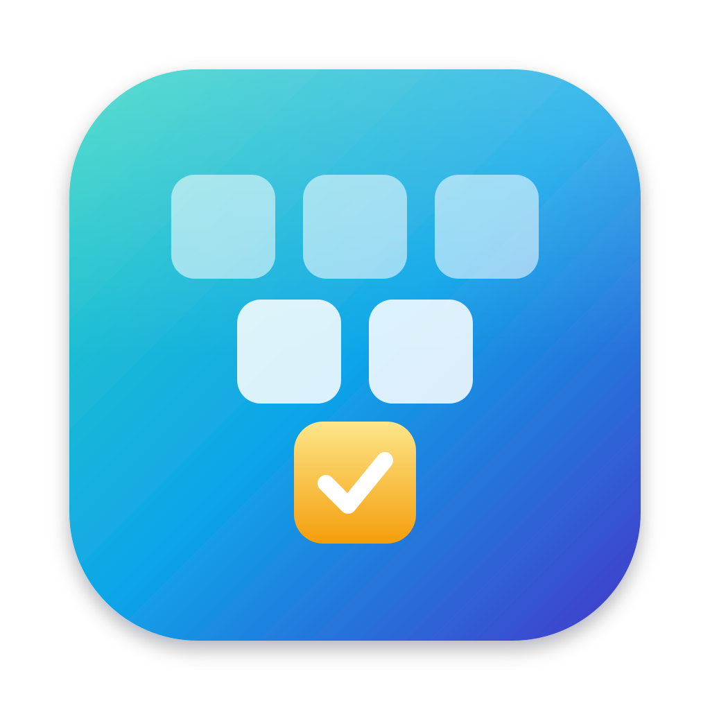
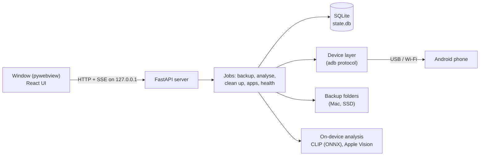

<p align="center">
  
</p>

<h1 align="center">Sift</h1>

<p align="center">
  <strong>Back up an Android phone to your Mac, verify every copy, then free space on the phone safely.</strong><br>
  Local only: your photos never leave your Mac.
</p>

<p align="center">
  <a href="https://github.com/avina5hkr/sift/actions/workflows/ci.yml"></a>
  <a href="https://github.com/avina5hkr/sift/releases/latest"></a>
  
  <a href="LICENSE"></a>
</p>

---

Sift is a macOS desktop app for people whose Android phone is full. It copies everything that
matters from the phone to a folder on your Mac and to an external SSD, checks every copy byte for
byte, and only then helps you delete from the phone: duplicates, near-duplicates, forwarded
junk, or everything except a short list you choose to keep.

> **Status: beta (0.x).** Sift is used daily on real phones, and its delete paths are covered by
> extensive tests, but it is young software. Keep your own extra backup until you trust it.

## Contents

- [Features](#features)
- [How Sift keeps your data safe](#how-sift-keeps-your-data-safe)
- [Privacy](#privacy)
- [Install](#install)
- [First run](#first-run)
- [Where Sift keeps things](#where-sift-keeps-things)
- [Uninstall](#uninstall)
- [Troubleshooting](#troubleshooting)
- [Build from source](#build-from-source)
- [How it works](#how-it-works)
- [Documentation](#documentation)
- [Contributing, security and licence](#contributing-security-and-licence)

## Features

### Backup

- Copies photos, videos, screenshots, WhatsApp media and chat backups, documents, downloads and
  recordings over USB (or Wi-Fi on Android 11+), into a Mac folder and an SSD folder.
- Verifies every copy by SHA-256 and keeps a dated confirmation of what is safely backed up.
- Resumes after a disconnect, survives a quit or a crash mid-copy, and adopts an existing backup
  folder in place. Backup files are written once and never changed.

### Free space

- **Duplicates:** identical files in several places on the phone; the camera original is kept.
- **Near-duplicates:** resized, re-compressed or forwarded copies of the same photo or video.
- **Junk suggestions:** greeting cards, memes and forwards, found with an on-device image
  model and text reading (English and Hindi), and taught by your own Junk/Keep choices.
- **Browse** the phone by folder and delete what you pick, or **Clean slate**: keep a short list
  and clear the rest, once it is verified as backed up.
- Deleted files can go to a **quarantine** in the backup folder first, and can be restored to the
  phone.

### Apps and health

- App sizes and last use, with safe uninstall (WhatsApp and authenticator apps are protected).
- A phone health report (storage, memory, battery, temperature, the busiest apps) and a
  checklist for a factory reset you do yourself.

## How Sift keeps your data safe

These rules are not settings; they hold whatever you configure. The full list, and which
behaviours are only defaults, is in [docs/defaults-and-safety.md](docs/defaults-and-safety.md).

- **A phone file is deleted only when every backup folder holds a good copy.** The copy's
  content is hashed from the disk during the checks and again right before each delete.
- **The phone file must be the one that was checked.** The phone re-hashes each batch just
  before deleting it, and each file is re-checked for size and time right before its own delete.
- **Nothing is deleted without you.** You tick the files and confirm; large or unusual deletes
  need you to type the count. The phone's identity is checked first.
- **Backups are append-only.** Sift never overwrites or changes a file in a backup folder.
- **Restores are proven.** A restored file is hashed on the phone before it counts, and an
  upload never replaces or removes a file that is not its own.
- **When in doubt, keep.** Anything not yet analysed, unreadable, or protected (camera
  originals, documents, IDs, WhatsApp databases) is never suggested for deletion.

## Privacy

Sift works entirely on your Mac. There is no account, no analytics and no cloud service.

- The interface is a local web page served only on `127.0.0.1`, protected by a per-launch token.
- Sift goes online only for two downloads, and only after asking you:
  - Google's Android platform-tools (`adb`), whose code signature is checked for Google's team ID;
  - the CLIP image model (about 160 MB, from Hugging Face), with pinned SHA-256 hashes.
- ONNX Runtime's telemetry is switched off.

## Install

**Requirements:** a Mac with Apple Silicon running macOS 14 or later, and an Android phone with
USB debugging turned on (Wi-Fi pairing needs Android 11 or later).

1. Download `Sift-X.Y.Z-macos-arm64.dmg` from the
   [latest release](https://github.com/avina5hkr/sift/releases/latest), and optionally check it:

   ```bash
   shasum -a 256 -c Sift-X.Y.Z-macos-arm64.dmg.sha256
   ```

2. Open the dmg and drag **Sift** to **Applications**.
3. Open Sift once. It is ad-hoc signed but not notarised by Apple, so macOS stops the first
   launch. Go to **System Settings → Privacy & Security** and click **Open Anyway** (on
   macOS 14 you can also right-click Sift and choose **Open**). You only do this once.

## First run

1. On the phone, turn on **Developer options → USB debugging**, connect it by USB, and accept the
   "Allow USB debugging?" prompt.
2. Sift asks to download `adb` if your Mac does not have it.
3. Choose the Mac backup folder and, if you have one, the SSD folder. macOS asks once for access
   to the external drive.
4. Run a backup. When it is confirmed, **Free space** opens up. **Analyse** asks to download the
   image model the first time.

## Where Sift keeps things

| What | Where |
| --- | --- |
| Your backups | The Mac and SSD folders you chose |
| Database, settings (`config.toml`), logs | `~/Library/Application Support/Sift` |
| Thumbnails and other caches | `~/Library/Caches/Sift` |

## Uninstall

Drag Sift to the Bin, then delete `~/Library/Application Support/Sift` and
`~/Library/Caches/Sift`. Your backup folders are never touched.

## Troubleshooting

- **"Sift cannot be opened" or "Apple could not verify Sift":** see step 3 of [Install](#install).
- **The phone is not found:** use a data cable (not a charge-only one), unlock the phone, accept
  the USB debugging prompt, and set the USB mode to *File transfer* if the phone asks.
- **Something went wrong:** Settings → General → *Open the logs and export diagnostics* shows
  the activity log and makes a zip of logs and settings. A crash writes `logs/crash-DATE.txt` and
  shows a dialog with *Open logs*. Please attach what is relevant (check it for anything private
  first) when you [open an issue](https://github.com/avina5hkr/sift/issues).

## Build from source

You need macOS 14+ on Apple Silicon, the Xcode Command Line Tools, [uv](https://docs.astral.sh/uv/)
and Node.js 24 (`web/.nvmrc`). uv installs Python 3.14 for you.

```bash
git clone https://github.com/avina5hkr/sift.git && cd sift
uv sync --locked                 # Python dependencies
npm --prefix web ci              # web dependencies
make dev                         # run against a fake phone (no device needed), data in .dev/
make build                       # Sift.app and build/package/Sift-VERSION.dmg (arm64)
```

| Command | What it does |
| --- | --- |
| `make dev` | Runs Sift against an invented phone; your real data is never touched |
| `make test` | Python tests (about 1,800; fake phones and temporary folders only) |
| `make lint` | ruff and mypy |
| `make web-test` | Web lint, type check and unit tests |
| `make e2e` | Playwright end-to-end tests against the fake phone |
| `make bench` | Benchmarks (not part of the test run) |
| `make build` | The app and dmg; `--self-check` in the built app checks every native part loads |

A build can include a starter set of your own Junk/Keep labels (Teach → Save teaching):
`SIFT_TEACHING=path/to/teaching.json make build`. Nothing is bundled unless you set it, and the
release builds never include one.

## How it works



- **Device layer** (`src/sift/device`): speaks the adb wire protocol directly to the adb server
  (listing, streaming reads, hashing on the phone), with a fake phone for tests.
- **Backup** (`src/sift/backup`): scan, pull to a staging file, hash, publish with an exclusive
  create, replicate to the SSD, verify, confirm.
- **Analysis** (`src/sift/analysis`): metadata, perceptual hashes, near-duplicate groups, text
  reading with Apple Vision, image embeddings with CLIP on ONNX Runtime, clusters for teaching.
- **Clean-up** (`src/sift/cleanup`): duplicate and junk tabs, the classifier, calibration,
  preflight checks, the deleter, quarantine and restore.
- **Server and UI** (`src/sift/server`, `web/`): a local API with server-sent events, and a React
  and TypeScript interface.

[docs/CODEMAP.md](docs/CODEMAP.md) lists every module.

## Documentation

| Document | For |
| --- | --- |
| [docs/defaults-and-safety.md](docs/defaults-and-safety.md) | The safety rules, the preference defaults, and model identity |
| [docs/CODEMAP.md](docs/CODEMAP.md) | A one-line map of every module |
| [docs/releasing.md](docs/releasing.md) | How releases are versioned, built and published |
| [docs/README.md](docs/README.md) | Everything else: design records, spikes and milestone plans |
| [CHANGELOG.md](CHANGELOG.md) | What changed in each release |
| [THIRD_PARTY.md](THIRD_PARTY.md) | Third-party software in the app and its licences |

## Contributing, security and licence

- Contributions are welcome. Read [CONTRIBUTING.md](CONTRIBUTING.md) first; changes to anything
  that deletes or writes to a phone get extra review.
- Report security problems privately, as described in [SECURITY.md](SECURITY.md).
- Sift is released under the [MIT licence](LICENSE). Third-party components keep their own
  licences ([THIRD_PARTY.md](THIRD_PARTY.md)).

Sift is not affiliated with Google, Apple or WhatsApp. Android is a trademark of Google LLC.
